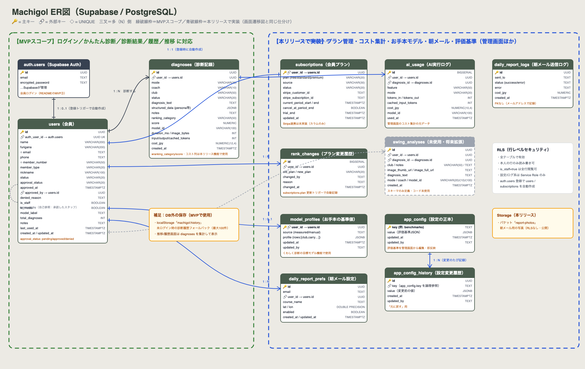

# まちゴル — ゴルフスイングAI診断アプリ

本番URL: https://machigol.vercel.app

※本リポジトリは卒業制作の企画書（README）提出用です。
アプリ本体のソースコードは、運用中サービスの独自診断ロジック等を
含むため、別のPrivateリポジトリで管理しています。

## 1. サービス概要

**「まちゴル」は、ゴルフの上達に足踏みしているゴルファーが、
弾道計測器の画面写真を撮ってアップするだけで、AIコーチが数値を読み取り、
ミスの根本原因と練習法を診断してくれるサービスです。**

計測器の数値を読み解けないまま闇雲に練習しているゴルファーの
「頑張っているのに上達しない（しかも本人は気づけない）」という課題を、
数値とスイングの因果関係を"見える化"することで解決し、
日々の練習を上達に直結する改善サイクルに変えます。

---

## 2. このアイデアはどこから生まれたか

### 2-1. きっかけとなった体験・感情

ゴルフレッスン（1回90分）で弾道計測器を使った練習をしていたとき、
画面に表示される専門的な数値（スピン量、打ち出し角など）の意味が分からなかった。

しかし、コーチに「そんなことも知らないの？」と思われそうで聞けなかった。
自分はある程度上手い方だったので、なおさら「今さら聞けない」という
恥ずかしさがあった。

その場で自分で調べようにも、90分という限られたレッスン時間の中で
検索していては、練習時間そのものが削られてしまうジレンマもあった。

### 2-2. なぜそれが「気になった」のか

- 早く上達したいという強い気持ちがあり、感覚ではなく
  **数値でゴルフの結果を客観的に見ることが上達に不可欠**だと考えているから
- 自分の変化・成長を目に見える形で記録し、実感したいという価値観があるから
- 「上手い人ほど今さら基本を聞けない」という心理を、自分自身が体験したから

---

## 3. 課題の整理

### 3-1. 表に見えている困りごと

弾道計測器に表示される数値（ダイナミックロフト、スピンロフト、
スピン量など）の意味が分からない。

### 3-2. 本当に解決したい課題は何か

- **なぜ①** 数値の意味が分からないと困るのか？
  → 数値が「どのスイング軌道から生まれ、どんなミスにつながるか」という
    **因果関係**が分からないから。ドロー・フェードなど球筋のコントロールには
    この因果関係の理解が不可欠。

- **なぜ②** 因果関係が分からないと何が起きるのか？
  → 数値を間違って解釈し、**良かれと思って逆効果の練習**をしてしまう。

- **なぜ③** 逆効果の練習を続けると何が起きるのか？
  → **上達が遅れる。しかも本人はそれに気づけない。**
    ゴルフには「悪い要素×悪い要素が相殺して、たまたま良い球が出る」
    ことがある。球筋が良く見えるため本人は順調だと思い込むが、
    悪い要素を1つ直した途端、隠れていたもう1つの欠陥が表面化する。

→ **本当に解決したい課題：**
  数値を正しく読めないアマチュアゴルファーが、間違った自己解釈のまま
  逆効果の練習を重ね、**「頑張っているのに上達しない」状態に
  本人が気づかないまま陥ってしまうこと。**
  （かつ、中級者ほど「今さら人に聞けない」ため、独りで抱え込む）

---

## 4. 想定ユーザーについて

### 4-1. 想定しているユーザー

**「週4回練習場に通い、月2回は計測器付きのレッスンを受けている、
ゴルフ歴20年・シングル入り目前の50代ゴルファー」**

年齢設定：
  - 年齢：50代
  - 理由：20〜30代はまだ体力・パワーでゴルフができてしまうため、
    数値で細かく分析しようとする層は少ない。50代になると力に頼れなくなり、
    「理屈で上達しよう」という意識に切り替わる。またゴルフ歴が長いほど
    「今さら数値の意味を人に聞けない」心理が強く、独学で誤解したまま
    練習しがちなため、このアプリが最も必要になる。

生活・状況設定：
  - 生活・状況：週4回練習場で練習し、月2回は計測器を使ったレッスンに
    通っている。数値は毎回目にしているが、意味を正確に理解できていない。
  - 理由：レッスン時間は90分と限られており、その場で数値の意味を
    調べる時間はない。計測器の画面を撮影してアップするだけで
    AIが診断してくれるため、レッスン時間を削らずに、練習の合間や
    帰宅後に「なぜそのミスが出たか」を理解できる。

環境設定：
  - 環境：計測器のある練習場・レッスンスタジオ
  - 理由：計測器は数値を「表示」するだけで「解釈」はしてくれない。
    その解釈の部分（数値→スイングの因果→練習法）をAIコーチが
    埋めることで、計測器を「ただの記録装置」から「上達の道具」に変える。

### 4-2. 自分とユーザーの距離

**自分自身**

開発者自身（54歳・ゴルフ歴20年・シングル入り目前）が、
「数値の意味が分からないのに、上手いからこそ今さら聞けない」
という体験の当事者そのものである。

週4回の練習・月2回の計測器付きレッスンという生活も
ペルソナと完全に一致しており、「自分が本当に欲しいもの」を
作っている。加えて、同じ課題を抱えるレッスン仲間や
トップアマ層が身近におり、実際の利用者として
フィードバックをもらえる環境がある。

### 4-3. 実際に使われる可能性について（需要・存在確認）

- **すでに運用中であり、約300名が利用している。**
  アクティブユーザーは毎日利用しており、評判も良い。
  特にトップアマチュアの利用者が毎回数値をチェックし、
  「自分の弾道を正しく理解するうえで意味がある」と評価している。
- 使う場面：練習場・レッスンで計測器の数値を見た直後
- 代替手段：その場でのGoogle検索、コーチへの質問
  → 検索は時間がかかり情報が断片的。コーチへの質問は
  「今さら聞けない」心理的ハードルがある。
  **写真1枚で数値を読み取り即診断**というスピードと、
  **誰にも聞かずに済む**心理的安全性が、置き換える理由になる。

### 4-4. ユーザーがサービスを導入して利用するまでのイメージ

**【知る・始めるきっかけ】**
本アプリは、開発者が関わるゴルフレッスン場「まちゴル」の
レッスン受講者に直接案内する形で導入する。
計測器を使ったレッスンの場で「この数値の意味、アプリで診断できますよ」
と案内できるため、課題を感じたその瞬間に導入してもらえる。
（現在は無料〜低価格で提供し、フィードバックを集めている段階）

**【最初の一歩】**
会員ログイン後、練習中に計測器の画面をスマホで撮影して
アップロードするだけ。特別な入力作業は不要。

**【使い続ける理由】**
1. **成長の記録が蓄積される**：診断履歴がサーバーに保存され、
   端末をまたいで過去の診断を振り返れる。「自分がどう変化・成長
   したか」を目に見える形で実感できる。
2. **毎日の結果がメールで届く**：練習結果の通知が習慣化の
   トリガーになる。
3. **やる気を引き出す診断トーン**：AIの診断文は
   「よくできている。ただ、ここがもう少しできれば、さらに
   こんなことができる」というトーンに統一。ダメ出しではなく
   「次の一歩」を示すことで、練習に行きたくなる循環を作る。

---

## 5. 既存サービス・競合調査

### 5-1. 似たサービスの調査

- サービス名：Tracy（トラックマン社のAIスイング解析）
- URL：https://www.trackman.com/blog/golf/tracy-the-ai-powered-swing-analysis-tool-in-trackman
- どんなことができるか：トラックマン計測器のデータをAIが解釈し、
  スイングの非効率な部分を検出して改善エリアを提示する。
  コーチングを置き換えるのではなく、コーチと併用して
  レッスンを補助することを想定したツール。

（参考）FlightScope社もAI搭載レンジファインダー「i4」等を展開して
いるが、こちらはコース上でのクラブ選択支援が中心であり、
「計測数値の意味を解釈して教える」領域とは異なる。

### 5-2. それでも自分が作りたい理由

メーカー純正のAI解析には、実際に触れてみて次の不満・違和感があった。

1. **機材に縛られる**：トラックマンを持っている（またはある施設に
   通える）ことが前提。高価な機材とセットでしか使えない。
2. **価格が高い**：メーカー系のAI解析サービスは1人あたり月1万円級の
   価格帯になりがちで、アマチュアが気軽に始められない。
3. **困ったときに相談できる人がいない**：AIの診断結果に疑問が
   湧いても、その先を聞ける相手がいない。診断が「言いっぱなし」で終わる。

### 5-3. 差別化を「体験価値」で表現する

このアプリは、
**「数値の意味を今さらコーチに聞けない中級以上のゴルファー」の
「計測器の数値を見て『なぜこのミスが出たんだろう』と
モヤモヤした、その瞬間」を一番助けるアプリ**である。

- 私のアプリの差別化ポイント：
  1. **どのメーカーの計測器でも、画面写真1枚で診断できる**
     （機材縛りなし・入力作業なし）
  2. **リアルのレッスン場と一体**：まちゴルには3人のプロが在籍。
     AIの診断で解決しない疑問は、練習中でもその場でプロに
     カジュアルかつスピーディーに聞ける。「AIだけ」でも
     「人だけ」でもない、両方の良さを組み合わせた体験。
  3. **独自の判断基準値**：汎用AIの一般論ではなく、アマチュア目線で
     「まちゴルの上手い人たち」を基準にした独自の基準値を構築し、
     継続的に育てている。「誰の知見をベースに診断するか」という
     診断ロジックそのものが独自資産である。

---

## 6. このサービスで提供したい価値

### 6-1. ユーザーの変化

- **行動の変化**：
  「何が悪いか分からず闇雲に打つ」練習から、
  「①計測→②AI診断で良い点・悪い点を把握→③提案されたスイング修正を
  試す→④また計測して記録に残す」という**改善サイクルを回す練習**に変わる。

- **気持ちの変化**：
  「自分では順調なつもりだが、実は間違っているかもしれない」という
  漠然とした不安が消え、「今の課題はこれだ」と分かって練習に
  向かえるようになる。診断履歴で自分の成長が見えるため、
  練習のモチベーションが続く。

- **考え方の変化**：
  「上達はレッスンで教わるもの」から「レッスンとレッスンの間の
  **日々の自主改善こそが上達の本体**」へ。
  （まちゴル在籍のレッスンプロも「週1回のレッスンだけでは効果が
  出ない。日々の改善を支えるこのアプリは有効」と評価している）

### 6-2. 価値を一文で表す

**「このサービスは、計測器の数値を読み解けないまま闇雲に練習している
ゴルファーが、今の課題を"見える化"して、日々の練習を
上達に直結する改善サイクルに変えられるようになるサービス」**

---

## 7. このアプリで実現すること

### MVPで作る機能

**基準：「数値が読めず逆効果の練習をしてしまう」という課題を
解決できるか、を検証するための最小構成**

1. **画像AI診断（核）**
   計測器の画面写真をアップ → AIが数値を読み取り、
   ミスの原因と練習法を診断（まずは簡易診断のみ）
2. **使用クラブの手入力**
   診断の精度に必須の情報のため、MVPから含める。
   ただしMVPでは手入力とし、AIによる自動抽出は後回しにする
3. **会員ログイン＋診断履歴のサーバー保存**（Supabase）
   本サービスの原点は「成長の記録を残して実感できること」。
   履歴が蓄積されて初めて、その人だけの"オンリーワンの情報"となり、
   継続利用の価値が検証できるため、MVPに含める

### 本リリースで作る機能

- **詳細診断モード**（1500〜2500字のストリーミング応答）
- **コーチ切替機能**（A〜Dの4コーチ＋許可メール制の限定コーチ。
  MVPでは1コーチで診断価値を検証し、その後「誰の知見で診断するか」
  を選べる形に拡張する）
- **使用クラブの画像AI自動抽出**（手入力の置き換え）
- **用語集**（31語、❔ボタン＋専用ページ）
- **毎日のメール通知**（継続の仕掛け）
- **管理画面**（利用者属性表示＋月別AIコスト集計）

---

## 8. このアプリの懸念点とその対策

### 懸念点①：模倣されるリスク

- **何が問題になりそうか**：
  「計測器の画面写真をAIで読み取って診断する」という仕組み自体は、
  技術的に特別難しいものではないため、同様のサービスが
  後発で登場する可能性がかなり高い。

- **なぜそう思うか**：
  実際に自分が短期間で構築できたこと、また計測器メーカー
  （トラックマンのTracy等）がすでにAI解析の領域に
  参入していることから。

- **そのために考えている対策**：
  「上辺」は真似できても、**中身は真似できない**構造を作る。
  1. **診断の質を日々育てる**：どんな解説をするか、解説だけでなく
     「こういうレッスン・練習をしたらいい」という提案まで踏み込めるか。
     この診断ロジック（誰の知見を、どんな基準値で使うか）は
     まちゴルで日々磨き続けている独自資産であり、
     コピーした瞬間の静的な模倣では追いつけない。
  2. **リアルのレッスン場との一体運営**：3人のプロが在籍する
     レッスン場と一体でサービスを提供する体験は、
     アプリ単体のコピーでは再現できない。

---

## 9. 今後の展開・発展の方向性

### 今考えている発展案

- **機能追加の方向性**：
  1. **初心者向けモードの追加**：MVPのターゲットは経験者だが、
     「打った結果、何が起きたのか」を素早く正しく知りたい
     本当の初心者向けに、専門用語を使わない診断モードを追加する
  2. **プロの知見のAI化（ベクトルDB化）**：まちゴル在籍の
     3人のレッスンプロの個性・教え方を、音声データ等から
     ベクトルデータベース化し、「あたかもそのプロが直接
     アドバイスしてくれる」診断を構築する。
     （実際に、許可を得た特定プロの知見をベースに全診断を行う
     仕組みを開発者専用に構築・運用済み。
     「誰の知見をベースに診断するか」のロジック構築こそ
     今後の最重要の鍵と考えている）
  3. **コーチ向けダッシュボード**：診断履歴の蓄積を活かし、
     レッスンプロが「自分の生徒がどう成長しているか」を
     見られる機能。日々の自主練とレッスンがつながる

- **機能以外の工夫（事業の広がり）**：
  4. **他のゴルフ練習場・スクールへの展開**：まちゴルのように
     小規模でも先進的なツールを持ちたいスクールに展開する。
     その際、各スクールの「オリジナル（独自の基準値・
     所属プロの知見）」を載せられる仕組みにすることで、
     単なるアプリ配布ではなく、各拠点の独自資産を育てる
     プラットフォームを目指す

- **データが溜まると何ができるか**：
  診断履歴＝個人の成長記録という"オンリーワンの情報"が蓄積される。
  独自の基準値も利用データとともに育っていく

---

## 10. 技術スタック（手段としての技術）

### 10-1. 使用予定の技術

- フレームワーク：Next.js 16（App Router）+ TypeScript + Tailwind CSS
- DB / 認証：Supabase（PostgreSQL + Supabase Auth）
- デプロイ先：Vercel（Pro プラン・月額20ドル）
- AI：Claude Sonnet 4.6（Vercel AI Gateway 経由）

### 10-2. 技術選定の比較検討

**■ フレームワーク**

| 候補 | 採用/不採用 | 理由 |
| --- | --- | --- |
| Next.js | 採用 | AI診断が核のアプリのため、Vercel AI Gatewayとの連携のしやすさ（ストリーミング応答等）が決め手。AIコーディングツールで両方を実際に試作・比較した結果、Next.jsの方が開発がスムーズだった |
| Ruby on Rails | 不採用 | カリキュラムで学習済みで候補だったが、AI連携（ストリーミング応答・AI Gateway）の実装のしやすさでNext.jsに劣ると判断した |

**■ AIモデル**

| 候補 | 採用/不採用 | 理由 |
| --- | --- | --- |
| Claude Sonnet 4.6 | 採用 | 複数モデルを実際に診断タスクで比較検証した結果、品質とコストのバランスが最も安定していた |
| その他のモデル | 不採用 | 品質・コスト・応答の安定性のいずれかで Sonnet 4.6 に及ばなかった |

**■ インフラ**

| 候補 | 採用/不採用 | 理由 |
| --- | --- | --- |
| Vercel + Supabase | 採用 | Next.jsとの相性が良く、セキュリティ面の信頼性が高い。Supabaseは認証（Auth）とDBがセットで、会員ログイン＋診断履歴保存を素早く構築できた |

- **今回チャレンジしたい点**：AI診断ロジック（プロンプトの base + mode + coach 合成）の継続的な改善、プロの知見のベクトルDB化
- **不安な点**：AIコストの管理（対策として管理画面に月別AIコスト集計を実装済み）

---

## 11. 画面遷移図

**Figma：** https://www.figma.com/design/DMs13vKV2gTsTIZk947Nqf/Machigol-%E7%94%BB%E9%9D%A2%E9%81%B7%E7%A7%BB%E5%9B%B3?node-id=0-1&p=f

図は上下2段に分けています。

- **上段（緑の破線枠）＝ MVPスコープ**
  「7. このアプリで実現すること」の「MVPで作る機能」に対応する画面群。
  ログイン → 承認待ち → ホーム（診断トップ） → 診断結果 → 診断履歴 → 推移
- **下段（青の破線枠）＝ 本リリースで実装**
  同章の「本リリースで作る機能」に対応する画面群。
  管理画面（`/admin` 系）／ランキング／用語集

### 補足

- 会員登録画面は設けていません。登録は練習場の受付で行う運用のためです。
- パスワードは全会員共通とし、変更・再設定の画面は持ちません。
  ログイン情報は店内に掲示し、パスワードは運営側で定期的に変更します。
- 会員登録後は先生（管理者）の承認が必要なため、承認待ち画面（`/pending`）を設けています。

---

## 12. ER図

**Figma：** https://www.figma.com/design/DMs13vKV2gTsTIZk947Nqf/Machigol-%E7%94%BB%E9%9D%A2%E9%81%B7%E7%A7%BB%E5%9B%B3?node-id=49-354

画面遷移図と同じ仕分けで、左右2つの枠に分けています。

- **左（緑の破線枠）＝ MVPスコープ**
  ログイン／かんたん診断／診断結果／履歴／推移 に対応するテーブル群。
  `auth.users`（Supabase Auth）→ `users`（会員・承認フロー）→ `diagnoses`（診断記録）。
  履歴・推移の画面は `diagnoses` の集計で実現します。
- **右（青の破線枠）＝ 本リリースで実装**
  `subscriptions`（会員プラン）／`ai_usage`（AIコスト集計）／`model_profiles`（お手本の基準値）／
  `app_config`・`app_config_history`（評価基準の正本と変更履歴）／`daily_report_prefs`・`daily_report_logs`（朝メール）

### 補足

- 全テーブルで行レベルセキュリティ（RLS）を有効化し、本人の行のみ読み書き可・スタッフ（`is_staff`）は全行閲覧可としています。
- `auth.users` への登録をトリガーに `users` と `subscriptions` の行を自動作成します。
- 未ログイン時の診断履歴は localStorage をフォールバックとして使用します（DB外・最大100件）。

